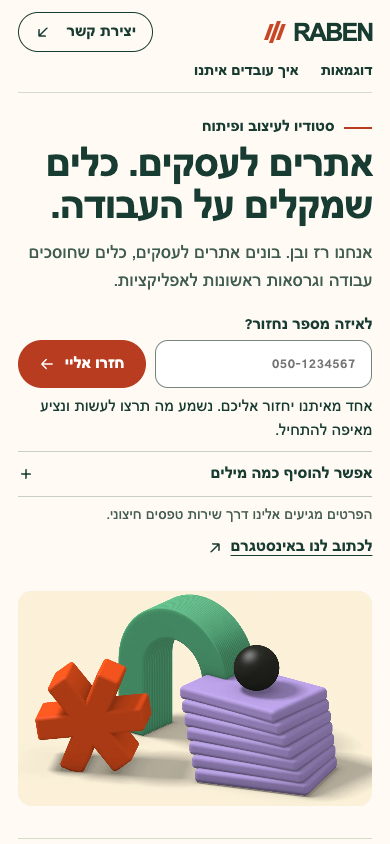
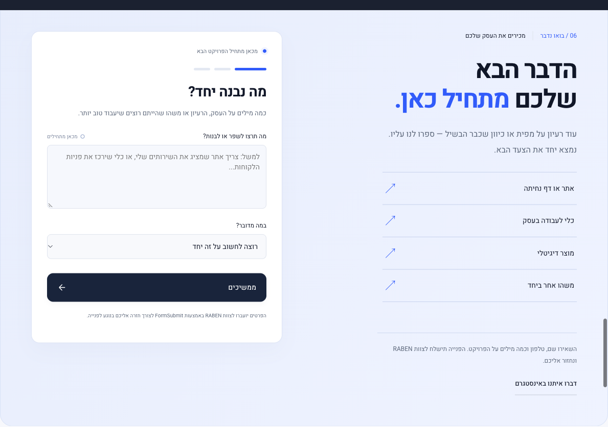

# RABEN

אתר תדמית בעברית, RTL, ללא שלב build. קובצי הממשק נמצאים ב־`dist/`; פונקציית Node.js ב־`api/projects.js` מאמתת את הפרויקטים לפני הצגתם.

## עריכת תוכן

ערכו את `dist/content.js`:
- `about`: טקסט ההיכרות.
- `capabilities`: רשימה אופציונלית, כרגע ריקה כדי לא לשכפל את כרטיסי השירותים.
- `offering`: הכותרת והתיאור הראשי של אזור השירותים.
- `services`: שלושה שירותים עם `id` (`website`, `tool`, `product`), `title`, `need`, `description`, `example`, `includes` ו־`kind`. המזהים מחברים בין הכרטיסים להמחשות; `kind` חייב להתאים לאפשרות בטופס.
- שינוי במסרי הליבה ובשירותים דורש גם עדכון התוכן החלופי ב־`dist/index.html`, כדי לשמור התאמה למבקרים ללא JavaScript.
- `projects`: מועמדים לתיק העבודות, לפי הסכמה שלהלן. רשימה ריקה מסתירה את כל אזור תיק העבודות ואת הקישור אליו בניווט, ללא הודעות מציין מקום.

טופס יצירת הקשר שולח פניות דרך FormSubmit לכתובת העסקית הקיימת. בכשל מוצעת העתקת הפרטים ופתיחת שיחה באינסטגרם. בדיקות הדפדפן משתמשות בתגובות מדומות ואינן שולחות הודעות אמיתיות.

## פרויקטים מאושרים ואימות ציבורי

יש להוסיף רשומה רק אחרי אישור מפורש להצגתה ולשימוש בתוכן ובתמונה שלה. הדוגמה היא סכמה בלבד, ואינה פרויקט לפרסום:

```js
{
  id: 'project-slug',
  title: 'שם הפרויקט',
  description: 'תיאור עובדתי קצר',
  url: 'https://your-public-domain.com/',
  category: 'אתר עסקי', // אתר עסקי | מוצר | פרויקט תוכנה | ניסוי
  publish: false,
  permissionGranted: false,
  concept: false, // true מסמן קונספט או דמו, גם כאשר אושר לפרסום
  expected: {
    titleIncludes: 'טקסט ייחודי מתוך כותרת העמוד',
    textIncludes: 'טקסט ייחודי שמופיע בתוכן הציבורי של העמוד'
  },
  image: '/assets/project.webp' // אופציונלי: צילום מסך מקורי ומאושר שנשמר מקומית
}
```

שני שדות `expected` מקבלים מחרוזת או מערך של עד חמש מחרוזות; כולן חייבות להופיע. אורך מינימלי: שלושה תווים לכותרת ו־12 לטקסט. יש לבחור טקסט ייחודי לפרויקט. האימות קורא HTML מהשרת, ללא הרצת JavaScript, ולכן פרויקט שמציג תוכן רק אחרי הרצת JavaScript יוסתר עד שיספק תוכן HTML ציבורי מתאים. `dist/content.js` הוא מקור התוכן היחיד; הפונקציה טוענת אותו מהחבילה ללא קובץ מועתק נוסף. זהו קובץ ציבורי ואין לשמור בו סודות או פרטים שאינם מיועדים לפרסום.

`GET /api/projects` מחזיר רק רשומות שעבורן `publish` ו־`permissionGranted` הם `true` ושעברו בדיקה אנונימית: HTTPS, תגובת HTML עם סטטוס 200, כותרת וטקסט תואמים, ללא מסך כניסה, חסימת Vercel, שגיאת 404 רכה או הפניית HTML. בקשת הבדיקה אינה משתמשת בעוגיות, באימות או במפתחות עקיפה. עד שתי הפניות HTTP מותרות בתוך אותו origin בלבד; שינוי דומיין או נתיב כניסה גורם להסתרה. כתובות עם פרטי גישה, כתובות IP וכתובות מקומיות אינן קבילות. השרת אינו מקבל כתובות לבדיקה מפרמטרים של בקשה.

האימות מוגבל לארבע שניות ולעד 512 KiB לכל עמוד, ולעד 12 מועמדים מאושרים, בארבע בדיקות במקביל. שגיאת רשת, timeout, תוכן חסר או אי־התאמה מסתיימים בהסתרת הפרויקט. מוחזרים רק שדות התצוגה, ובנוסף `checkedAt` ו־`expiresAt` ברמת התשובה. אישור ותנאי האימות אינם מוחזרים ב־API.

תוצאת האימות נשמרת עד חמש דקות. זמן ה־CDN שנותר מחושב מתוך אותה תפוגה, ללא `stale-while-revalidate`, כך ששתי שכבות המטמון אינן מאריכות את חלון האימות. אחרי פקיעת התוקף נדרשת בדיקה חדשה; כשל בטעינת ההגדרות מחזיר 503 ורשימה ריקה ללא מטמון. הבדיקה מוכיחה נגישות בזמן הבדיקה; שינוי באתר היעד עשוי להשתקף עד חמש דקות מאוחר יותר. האימות אינו מחליף אישור לפרסום או בדיקת זכויות בתוכן.

## קבצים

- `index.html`: מבנה, מטא־נתונים ותוכן הממשקים.
- `styles.css`: עיצוב, התאמה למובייל והעדפת reduced motion.
- `app.js`: רינדור תוכן, אימות פרויקטים וטופס יצירת קשר.
- `assets/raben-logo.png`: הלוגו המקורי שסופק על ידי המשתמש.

## תצוגה מקומית

לתצוגת הממשק בלבד, הריצו מתוך תיקיית `site/dist`: `python3 -m http.server 4173`, ופתחו `http://localhost:4173`. שרת סטטי אינו מפעיל את `/api/projects`, ולכן אינו מציג פרויקטים מאומתים. לבדיקה משולבת יש להשתמש ב־`vercel dev` משורש `site` או בפריסת Preview.

בדיקות האימות, ללא גישה לרשת או תלויות התקנה: `node --test tests/project-verifier.test.js` משורש `site` עם Node.js 20 ומעלה. הבדיקות מכסות הצלחה, כשלי HTTP, דף כניסה, 404 רכה, הפניות, timeout, הרשאות פרסום, התאמת תוכן ופקיעת מטמון.

האתר משתמש בגופן Heebo מ־Google Fonts, עם Arial כגופן חלופי כאשר אין חיבור. אין צורך בתלויות JavaScript. לפני פרסום תוכן חדש, בדקו מסך קטן, קישורים וניווט מקלדת.

## פריסה ל־Vercel

שורש הפרויקט הוא תיקייה זו. `vercel.json` מגדיר ממשק סטטי ללא שלב בנייה, עם פלט מתוך `dist/`, ופונקציית אימות שמקבלת את `dist/content.js` באמצעות `includeFiles`. לאחר חיבור הרפוזיטורי ל־Vercel אפשר לפרוס שינויים דרך Git. אין צורך לשנות הגדרות הגנה של פרויקט או להשתמש במפתח עקיפה. תיקיות `.vercel` ו־`.openai` אינן נכללות במאגר.

הדפדפן מסתיר את הכרטיסים עם פקיעת `expiresAt`, בודק מחדש בתום התוקף ובחזרה לטאב, ומנסה שוב לאחר כשל כעבור חמש דקות. הבדיקות מבוצעות בשרת בלבד.

## אייקוני SVG

האייקונים משתמשים בסט `symbol` מקומי בתוך `dist/index.html` ובמחלקת `icon` משותפת. רכיבים דינמיים ב־`dist/app.js` מפנים לאותו סט באמצעות `use href`. כולם דקורטיביים (`aria-hidden`, `focusable="false"`), עם תוויות טקסט, צבע `currentColor` ועובי קו 1.75. חצים פנימיים מצביעים שמאלה לפי RTL; קישור חיצוני מצביע באלכסון והחזרה למעלה מצביעה למעלה. האתר אינו React, לכן אין תלות ב־lucide-react או מעבר למסגרת חדשה.

## המסר — רז ובן, אתרים וכלים לעסקים

עיצוב עברי RTL בצבעי נייבי, כחול וליים על רקע בהיר חם. הפתיחה מציגה פסל אינסוף וקטורי מקורי שמסמל את החיבור בין רז ובן, טיפוגרפיה גדולה ומסגרת ויזואלית של סטודיו עצמאי. הפסל הוא SVG מקומי עם גרדיאנטים; הוא אינו מצריך WebGL, ספריית תלת־ממד או תמונה חיצונית. במחשב עם עכבר הוא מגיב בהטיה עדינה, שמתאפסת ביציאה ומושבתת בהעדפת הפחתת תנועה ובמגע.

הפתיחה מציגה את רז ובן בשמם ואת השירות המרכזי: ״בונים אתרים. מפתחים כלים. לעסק שלכם.״ שלושת השירותים מוצגים בכרטיסים שווי משקל עם צורך, פתרון ודוגמה: אתרים ודפי נחיתה, כלים לעבודה בעסק ומוצר דיגיטלי ראשון. ההמחשות מופיעות מיד לאחר השירותים, ולאחריהן ההיכרות עם השותפים והתהליך.

באזור ״איך זה נראה״ בוחרים בין שלוש המחשות: אתר לעסק, לוח מעקב אחר פניות וממשק לבקשת פגישה. בחירת צבע ותצוגת מחשב/נייד זמינה בהמחשת האתר. כל ההמחשות מסומנות כדוגמאות אפשריות שאינן עבודות לקוח או מערכות פעילות. השירות שנבחר יכול להמשיך לסוג פנייה מתאים בטופס, כולל האפשרות החדשה ״כלי לעסק״.

התהליך מתאר פעולות ותוצרים בכל שלב: היכרות והגדרה, עיצוב ודיוק, פיתוח ובדיקה. [מסמך תכנון המסר](docs/MESSAGE_STRATEGY.md) מפרט את ההיגיון, הבסיס העובדתי ובדיקות ההתאמה.

### התנהגות ואינטראקציות

- ניווט דביק ופס התקדמות קריאה שמתעדכן באמצעות `requestAnimationFrame`; ללא לולאת אנימציה מתמשכת.
- כניסת מקטעים באמצעות `IntersectionObserver`. התוכן גלוי כברירת מחדל, נשאר נגיש ללא JavaScript, נחשף עם פוקוס מקלדת ונשאר גלוי בהעדפת הפחתת תנועה.
- בחירת המחשה במקלדת או מכרטיס שירות מציגה לוח אחד בכל פעם, מעדכנת את ההסבר ואת קישור הפנייה. הקישור מעביר את סוג השירות לרשימת הטופס ולכפתורי הבחירה.
- בחירת סוג פרויקט באזור יצירת הקשר מעדכנת את `#kind`, את `aria-pressed` ואת הודעת הבחירה. הפוקוס עובר לשדה הרעיון והוא ממורכז במסך, גם בנייד. שינוי ידני ברשימה ואיפוס הטופס מסנכרנים את הבחירה.
- שאלות נפוצות עם `details` ו־`summary` מקוריים, קישור דילוג לתוכן ומצבי פוקוס גלויים.
- טופס FormSubmit, אימות הטלפון, מניעת שליחה כפולה ושמירת הפרטים בעת כשל נשמרו. אימות הפרויקטים נכשל באופן סגור; ניסיון חוזר לאחר חמש דקות חל גם על HTTP שגוי או נתוני אימות שפג תוקפם.

כותרת השירותים, שלושת הכרטיסים ותיאור העסק קיימים גם ב־HTML לפני טעינת JavaScript; רשימות התוכן ממשיכות להיטען מ־`content.js`. העיצוב והאינטראקציות נמצאים ב־`styles.css` ו־`app.js`, ללא תלויות JavaScript או שלב בנייה.

### צילומי מסך

תצוגת מחשב:


[תצוגת מחשב מלאה](docs/screenshots/desktop-full.png) · [המחשת כלי לעסק](docs/screenshots/examples.png)

תצוגת נייד מלאה:



### אימות השדרוג

- כל 25 בדיקות `node --test tests/project-verifier.test.js` עברו.
- `node --check dist/app.js` ו־`git diff --check` עברו.
- בדיקת Chromium ברוחבי 320, 360, 390, 600, 768, 1024, 1440 ו־1920 פיקסלים: ללא גלילה אופקית.
- שלוש ההמחשות נבדקו בכל אחד מ־8 הרוחבים — 24 שילובים ללא גלילה אופקית. נבדקו בחירה במקלדת, מעבר מחשב/נייד ובחירת צבע.
- נבדקו מעבר מכרטיס שירות להמחשה, העברת ״כלי לעסק״ לטופס ולחלופת הפנייה, ואיפוס הבחירה אחרי הצלחה מדומה.
- שאלות במקלדת, קישור דילוג לתוכן, הפחתת תנועה, פס ההתקדמות והטיית הפסל נבדקו בעיצוב זה או בבסיס השדרוג הקודם.
- נבדקו בחירת סוג פרויקט, סנכרון הרשימה, איפוס הבחירה ופוקוס שדה הרעיון בתוך חלון הנייד.
- נבדקו חשיפת מקטעים, פס התקדמות ל־100%, הטיית הפסל ואיפוסה; כותרת ותוכן וטופס נשארים גלויים כשה־JavaScript כבוי.
- נבדק ניסיון חוזר ל־API אחרי HTTP 503 באמצעות שעון מדומה: שתי בקשות בהפרש חמש דקות, ללא חשיפת פרויקטים לא מאומתים.
- טופס: טלפון לא תקין נחסם; תגובת כשל מדומה שומרת את הפרטים ומציגה חלופת אינסטגרם; הצלחה מדומה מאפסת את הטופס. לא נשלחו פניות אמיתיות.
- בדיקות הדפדפן מקומיות עם API פרויקטים ו־FormSubmit מדומים. אין בכך אימות של מסירת הודעות בפועל או של פריסת Production.


## רענון חוויית האתר — 10.11.2026

הפתיחה מסבירה מי הסטודיו ומה הוא בונה. הרצף: שירותים → המחשות אינטראקטיביות → היכרות → תהליך → שאלות → שיחה. כרטיסי השירות, הרקעים, המרווחים והניווט הפעיל יוצרים שפה משותפת לאורך העמוד.

השאלות משתמשות ב־`details` מקוריים, עם הנפשת גובה, שקיפות ותנועה בפתיחה ובסגירה. לחיצות חוזרות ממשיכות מהגובה הנוכחי. בהפחתת תנועה הפתיחה מיידית; ללא JavaScript התשובות נגישות כרגיל.

הפנייה היא שיחה בשלושה צעדים: צורך וסוג פרויקט, שם וטלפון, וסיכום אישי לפני השליחה. חזרה שומרת את הפרטים. בחירת שירות מבחוץ פותחת את הצעד הראשון עם השירות הנבחר. שדות הכרחיים מסומנים ברמזים ״מכאן מתחילים״, ״כדי שנכיר״ ו״כדי שנחזור״ ובחיווי מילוי עדין; `required` נשמר. ללא JavaScript מוצג הטופס המלא. השליחה והחלופה באינסטגרם משתמשות במנגנון הקיים.



אימות הרענון: Chromium ברוחבי 320, 390, 768, 1189 ו־1440 ללא גלילה אופקית; מעבר בין המחשות והעברת השירות לטופס; הנפשת השאלות ולחיצות חוזרות; חסימת תיאור ריק וטלפון שגוי, סיכום, חזרה ושמירת פרטים, הצלחה וכשל בשליחה מדומה ואיפוס לצעד הראשון. לא נשלחו הודעות אמיתיות. 25 בדיקות האימות, בדיקת תחביר JavaScript ו־`git diff --check` עברו. צילומי המסך עודכנו. שרת התצוגה הסטטי מחזיר 404 ל־`/api/projects` כצפוי; לא בוצעה פריסה. הפחתת תנועה וטופס ללא JavaScript נתמכים בקוד אך לא נבדקו מחדש בדפדפן ברענון זה.

כפתור ההמשך בשיחה רחב, בצבע נייבי, עם פינות מעוגלות וחץ SVG נפרד. הוא ממלא את רוחב אזור הפעולות כדי לתת המשך ברור לכל צעד.
