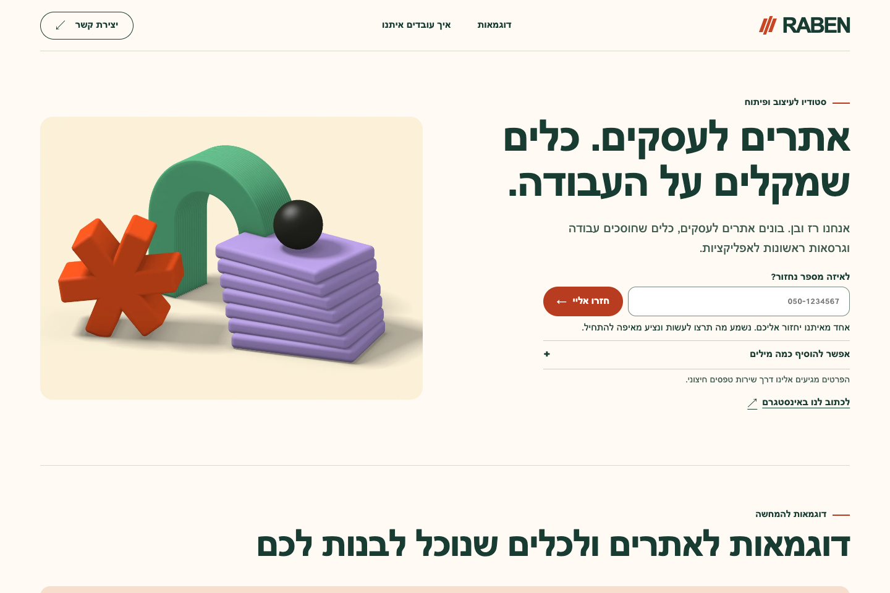

# RABEN / רז ובן

אתר סטודיו בעברית וב־RTL לעיצוב ופיתוח אתרים, כלים לעסקים ומוצרים דיגיטליים. HTML, CSS ו־JavaScript ללא תלויות ממשק וללא שלב build. פונקציית Node.js מאמתת עבודות לפני הצגתן.

## הרצה מקומית

מתוך תיקיית `site`:

```sh
python3 -m http.server 4173 --bind 127.0.0.1 --directory dist
```

פתחו [localhost:4173](http://localhost:4173). זהו שרת ממשק סטטי: `/api/projects` יחזיר 404 והעבודות יישארו מוסתרות. לבדיקה משולבת השתמשו ב־`vercel dev` משורש `site`.

## החוויה

מסך הפתיחה הוא סטודיו אינטראקטיבי. המבקר בוחר צורך ורואה המחשה מתאימה, ומשם יכול לעבור לשיחה עם סוג הפרויקט שכבר בחר. בהמשך מופיעים השירותים, השותפים, תהליך העבודה ושאלות נפוצות.

- **שירותים:** שלושה כרטיסים עם איורי ממשק מקומיים. כל כרטיס בוחר את ההמחשה המתאימה בהמשך העמוד.
- **המחשות:** אתר לעסק, לוח פניות וממשק לבקשת פגישה. אפשר להחליף צבע וגודל באתר לדוגמה. כולן מסומנות כהמחשות, ואינן עבודות לקוח או מערכות פעילות.
- **תנועה:** בפתיחה משטח ההמחשה נכנס בהטיה קלה. בבחירת דוגמה הטבעות מסתובבות, עמודות לוח הפניות או שלבי הפגישה מופיעים בהדרגה. ההנפשות מכבדות את העדפת המכשיר להפחתת תנועה.
- **שאלות:** רכיבי `details` מקוריים עם פתיחה וסגירה מונפשות. ללא JavaScript אפשר לפתוח אותן כרגיל.
- **שיחה:** שלושה צעדים — הצורך, פרטי קשר וסיכום אישי לפני השליחה. חזרה שומרת את הפרטים. רמזים ידידותיים מסמנים את השדות הנדרשים.
- **נגישות:** קישור דילוג, פוקוס גלוי, בחירה במקלדת והעדפת הפחתת תנועה. ללא JavaScript מוצגים תוכן וטופס מלאים.

התכנון המפורט מגדיר כל אחת מ־[50 רמות השיפור](docs/DESIGN-50.md) כקריטריון עיצובי שאפשר לבחון.

## צילומי מסך



[העמוד המלא במחשב](docs/screenshots/desktop-full.png) · [המחשות](docs/screenshots/examples.png) · [השיחה](docs/screenshots/contact.png)


## עריכת האתר

| קובץ | תפקיד |
| --- | --- |
| `dist/content.js` | תיאור הסטודיו, השירותים, מועמדים לעבודות ופרטי קשר ציבוריים |
| `dist/index.html` | מבנה, תוכן חלופי ללא JavaScript, מטא־נתונים וטופס |
| `dist/styles.css` | מערכת העיצוב והתאמה למסכים |
| `dist/app.js` | רינדור, המחשות, ניווט, שאלות ושיחה |
| `dist/assets/` | לוגו מקורי ואיורי SVG מקומיים |
| `api/projects.js` | נקודת הכניסה לאימות העבודות |
| `lib/` | אימות ציבורי ומטמון |

שינוי במסרי השירותים ב־`content.js` מחייב עדכון מקביל בתוכן החלופי ב־`index.html`. איורי השירותים הם המחשות דקורטיביות; אינם צילומי מסך של מוצר לקוח. הגופן Heebo נטען מ־Google Fonts עם Arial כחלופה.

## פניות ועבודות

הטופס שולח באמצעות FormSubmit לכתובת העסקית המוגדרת. בעת כשל הפרטים נשמרים ומוצעת העתקה ופתיחת אינסטגרם. הצלחה מוצגת רק לאחר תגובת הצלחה מהשירות. בדיקות משתמשות בתגובות מדומות ואינן שולחות פניות אמיתיות.

רשימת עבודות ריקה מסתירה את האזור וקישור הניווט שלו. עבודות מוצגות רק לאחר אישור מפורש לפרסום ואימות ציבורי מהשרת. [סכמת הנתונים וכללי האימות](docs/PROJECT-VERIFICATION.md) מפרטים הרשאות, תנאי נגישות, סינון כתובות, הגבלת משאבים ומטמון.

## בדיקות

```sh
node --test tests/project-verifier.test.js
node --check dist/app.js
node --check dist/content.js
git diff --check
```

תוצאות בדיקות הדפדפן וההיקף שנבדק מתועדים ב־[בדיקת העיצוב](docs/DESIGN-VERIFICATION.md).

## פריסה

שורש הפרויקט הוא `site`. `vercel.json` מגדיר פלט סטטי מתוך `dist` ללא בנייה, עם פונקציית האימות ו־`includeFiles` לתוכן. אין להכניס למאגר סודות או תיקיות `.vercel` ו־`.openai`.

[אתר RABEN בייצור](https://site-alpha-kohl-60.vercel.app) מתארח בפרויקט Vercel בשם `site`. הפריסה ידנית. לפרסום עדכון מריצים `vercel deploy --prod` מתוך תיקיית הפרויקט המקושרת.
